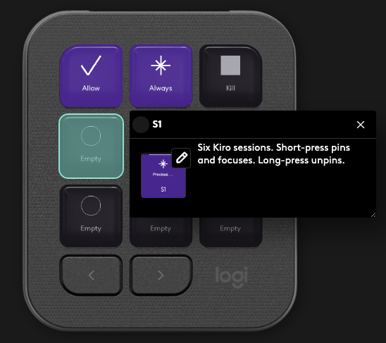
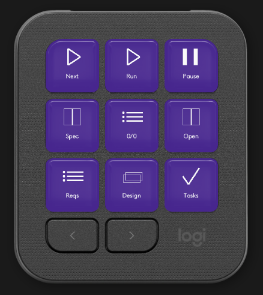
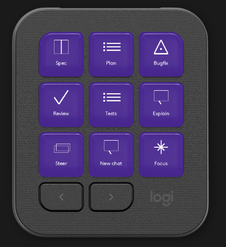
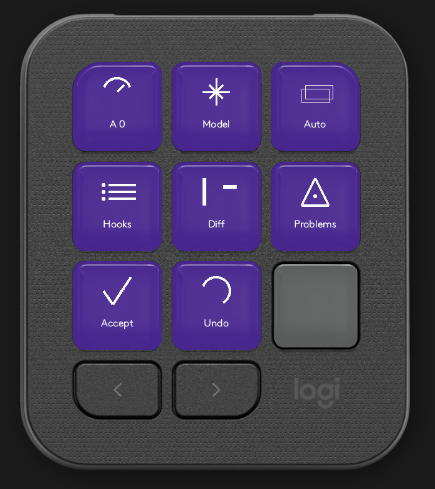

# Kiro Keypad

Kiro Keypad puts live Kiro chats on a Logitech MX Keypad. The keys use Kiro purple the way Excel uses green and Word uses blue: one field color, a white icon, and one caption.

<p align="center">
  
  
  
  
</p>

Two programs have to be running:

| Piece | Folder | Job |
|---|---|---|
| Logi plugin | [kiro-keypad-plugin](kiro-keypad-plugin/) | Draws the keys and listens for Kiro hooks on `127.0.0.1:47831` |
| Companion | [kiro-keypad-companion](kiro-keypad-companion/) | Runs inside Kiro and switches chats, inserts prompts, and reads spec files on `127.0.0.1:47832` |

```
Kiro hooks  →  plugin :47831  →  MX Keypad
Key press   →  companion :47832  →  Kiro commands
```

If the companion is not running, the plugin falls back to macOS keystrokes. Those keystrokes are a backup. Chat switching, Kill, and prompts are reliable once the companion is up.

The ports sit beside the Cursor Agent Cockpit (`47821` / `47822`), so both can run on the same Mac.

This version is macOS-first. The C# plugin can build on Windows, but the keystroke backup and the install paths below are for macOS. The dialpad is not part of this version.

## Run it from this repo

Do these in order from a clone of [KiroLogitechPlugin](https://github.com/akhilmadhumenon/KiroLogitechPlugin). A press does nothing until step 4 has been reloaded into the Kiro window you are actually using.

1. Install the [.NET 10 SDK](https://dotnet.microsoft.com/download), Node.js 18 or newer, [Kiro](https://kiro.dev/), and [Logi Options+](https://www.logitech.com/software/logi-options-plus.html). Plug in the MX Keypad. `dotnet --version` must start with `10`.
2. Build and install the companion, then reload Kiro. See [Companion](#1-companion). The status bar must show `Keypad:47832`, and `~/.kiro-keypad/companion.json` must exist.
3. Build the Logi plugin. See [Logi plugin](#2-logi-plugin). `curl -s http://127.0.0.1:47831/health` must return `"ok": true`.
4. Install the hooks and reload Kiro again. See [Hooks](#3-hooks).
5. In Logi Options+, assign the four pages under [Assign the keys](#4-assign-the-keys).
6. Grant Accessibility to **Logi Plugin Service** (System Settings → Privacy & Security → Accessibility). This is the backup path when the companion cannot run a command.
7. Press a filled chat key. The open Kiro tab should change, and the command palette should stay closed.

If the keys are drawn but a press does not change the chat, the companion is up and refusing the command. Reload the Kiro window after installing the companion. The plugin log at `~/Library/Application Support/Logi/LogiPluginService/Logs/plugin_logs/KiroKeypad.log` should stop saying `/v1/focus failed`.

## What you need

- macOS
- An MX Keypad (Loupedeck CT family), plugged in
- [Logi Options+](https://www.logitech.com/software/logi-options-plus.html) with the Logi Plugin Service installed. The plugin API is expected at `/Applications/Utilities/LogiPluginService.app/Contents/MonoBundle/PluginApi.dll`
- [Kiro IDE](https://kiro.dev/) 1.0.182 or newer, so global hooks load. A current 1.2.x build is what this repo is developed against
- The [.NET 10 SDK](https://dotnet.microsoft.com/download). `dotnet --version` must start with `10`. The .NET 8 SDK that ships on some Macs cannot build this project
- Node.js 18 or newer, and npm

Confirm the tools before you build:

```bash
dotnet --version          # 10.x
node --version            # v18 or newer
kiro --version            # or the full path in the companion step below
```

If `dotnet` is version 8, install the .NET 10 SDK and open a new terminal. If you installed it under `~/.dotnet`, put that directory first on `PATH`:

```bash
export PATH="$HOME/.dotnet:$PATH"
dotnet --version
```

## Install

Do these three steps from the repository root, then assign the keys in Logi Options+. After each step there is a check. Do not skip the Kiro window reload. Installing the extension does not start it in a window that is already open.

### 1. Companion

The companion is a Kiro extension. It is what actually changes the chat tab.

```bash
cd kiro-keypad-companion
npm install
npm run build
npx vsce package --no-dependencies --allow-missing-repository --allow-star-activation --out dist/kiro-keypad-companion.vsix
```

Install it with the `kiro` command if that is on your `PATH`. Otherwise use the binary inside the app:

```bash
kiro --install-extension dist/kiro-keypad-companion.vsix --force
```

```bash
"/Applications/Kiro.app/Contents/Resources/app/bin/code" --install-extension dist/kiro-keypad-companion.vsix --force
```

Then reload the Kiro window: Command Palette, **Developer: Reload Window**. A new install is not picked up by a window that was already open.

After the reload:

- The status bar shows `Keypad:47832`
- `~/.kiro-keypad/companion.json` exists. It holds the port and a token. Do not commit it
- Command Palette → **Kiro Keypad: Show Companion Status** reports the port

If the status bar never changes and `companion.json` is missing, the extension did not activate. Reload the window again. The extension supports untrusted workspaces, and it activates on startup.

The companion also contributes these shortcuts. They are the backup the plugin uses when it cannot reach the extension. They only exist after the extension is installed and the window has been reloaded:

| macOS | Command |
|---|---|
| Cmd+Option+Shift+Right | Next chat tab |
| Cmd+Option+Shift+Left | Previous chat tab |
| Cmd+Option+Shift+C | Cancel the chat turn |
| Cmd+Option+Shift+W | Close the current chat tab |

### 2. Logi plugin

From the repository root:

```bash
export PATH="$HOME/.dotnet:$PATH"   # only if dotnet 10 is not already first on PATH
dotnet build kiro-keypad-plugin/src/KiroKeypadPlugin.csproj -c Debug
```

A successful build does three things:

1. Compiles `kiro-keypad-plugin/bin/Debug/bin/KiroKeypadPlugin.dll`
2. Writes `KiroKeypadPlugin.link` into `~/Library/Application Support/Logi/LogiPluginService/Plugins/`. The link points at `kiro-keypad-plugin/bin/Debug/`
3. Opens `loupedeck:plugin/KiroKeypad/reload` so Logi Plugin Service loads the new build

If the reload URL fails, quit and reopen Logi Options+, or run:

```bash
open "loupedeck:plugin/KiroKeypad/reload"
```

Check that the plugin is listening:

```bash
curl -s http://127.0.0.1:47831/health
```

You want `"ok": true` and six slots. The log is `~/Library/Application Support/Logi/LogiPluginService/Logs/plugin_logs/KiroKeypad.log`. A good load line looks like `Kiro Keypad loaded`.

Grant **Accessibility** to Logi Plugin Service in System Settings → Privacy & Security → Accessibility. The keystroke backup (new chat, focus, kill, paste) is sent with `osascript`. Without Accessibility those presses do nothing when the companion is down.

### 3. Hooks

Hooks tell the keypad when a prompt is sent and when a tool wants to run.

```bash
./scripts/install-hooks.sh
```

That copies two files:

- `~/.kiro/hooks/kiro-keypad-relay.mjs`
- `~/.kiro/hooks/kiro-keypad.json`

Reload Kiro so the hooks attach. Global hooks apply to every workspace.

The relay reads the hook JSON from stdin and POSTs it to `http://127.0.0.1:47831/hook`. If the plugin is not running, the relay **allows** the tool so Kiro is not stuck. If the plugin is running and you press Deny, the relay exits with code 2 and Kiro blocks the tool. The gate waits up to 15 minutes, then denies.

Kiro still shows its own Allow / Deny dialog unless those tools are already allowed. To make the keypad the only prompt, merge [hooks/permissions.snippet.yaml](hooks/permissions.snippet.yaml) into `~/.kiro/settings/permissions.yaml`. Deny rules you already have still win. This snippet allows shell, `fs_write`, and MCP. Only add it if you want the keypad to be the approval.

Some Kiro builds do not recognize every trigger name in `hooks/kiro-keypad.json`. If the Kiro log says a trigger is unrecognized, that event never reaches the keypad. Open chats still show up, because the plugin reads Kiro's session list itself. The gate that blocks a tool is `PreToolUse`.

### 4. Assign the keys

In Logi Options+, select the MX Keypad, add the **Kiro Keypad** plugin, and make four pages. Each page is one group. Drag every action in the group onto the page in this order, left to right, top to bottom. The drawings on the keys are the captions. Options+ also lists a name under each action; that name is only the label in the assignment list.

**Page 1 — Kiro · Sessions**

```
[ Allow ] [ Always ] [ Deny / Kill ]
[  1    ] [  2     ] [  3          ]
[  4    ] [  5     ] [  6          ]
```

The six session actions are named S1 through S6 in the assignment list. On the keypad, an empty key shows `S1`–`S6`. A chat shows its title.


**Page 2 — Kiro · Spec**

```
[ Next ] [ Run  ] [ Pause ]
[ Phase] [ 3/11 ] [ Open  ]
[ Reqs ] [ Design] [ Tasks]
```


**Page 3 — Kiro · Flow**

```
[ Spec ] [ Plan ] [ Bugfix ]
[ Review ] [ Tests ] [ Explain ]
[ Steer ] [ New chat ] [ Focus ]
```


**Page 4 — Kiro · Studio**

```
[ Context ] [ Model ] [ Auto ]
[ Hooks   ] [ Diff  ] [ Problems ]
[ Accept  ] [ Undo  ] [ Term ]
```


## How the session page works

The six keys follow the chat tabs from left to right. Kiro does not let you drag tabs into a new order, so the keypad uses that same order. The first tab is key 1, the next is key 2, and so on. You can move between them without looking at the screen.

Open chats are picked up automatically about every 2.5 seconds. You do not assign a chat to a key by hand. If more than six chats are open, the keys stay with the **first six tabs** in that same left-to-right order.

A short press on a filled key switches Kiro to that chat. A long press (about half a second) unpins it. Allow, Always, and Deny / Kill follow the pinned chat, or the chat that is open when nothing is pinned.

### New chat

Press an empty key to start a chat on that key. One rule limits this: if a new chat exists and you have not sent a prompt in it yet, every other empty key focuses that unstarted chat instead of opening another one. This works in either direction, key 1 to key 6 or key 6 to key 1. After you send a prompt, empty keys can open another chat.

Chats that were already open in Kiro are treated as started, even when the title is still "New Session". They do not lock the keypad.

Pressing the **New chat** key on the Flow page follows the same rule.

### Allow, Always, Deny, Kill

When a gated tool is waiting, the third key says **Deny** and the session key lifts into the brighter purple. The keypad knocks once.

| Key | While a decision is waiting | After the decision is gone |
|---|---|---|
| Allow | Lets this tool run once | Does nothing useful until the next decision |
| Always | Lets this tool run, and remembers its name for this chat | Same |
| Deny / Kill | **Deny** only. The chat stays open | **Kill**. Stops the turn and closes the chat that is open |

You cannot kill a chat while a question is waiting. Deny first. The key switches to Kill. The next press stops the turn and closes that chat.

Kill closes the chat tab that is open in Kiro. If Kill is dim, there is no active chat to close.

### What the colors mean

| State | Field | What you see |
|---|---|---|
| Empty | `#19161D` | Muted icon, caption `S1`–`S6` |
| Resting / running | `#4C1D95` | White icon and caption. A running or pinned chat has a `#C6A0FF` bar on top |
| Tool in flight | `#4C1D95` | Icon pulses between white and `#C6A0FF` |
| Needs you | `#6D28D9` | Light-purple band on the bottom. The keypad knocks once |
| Done | `#4C1D95` | Check, small green pip (`#3DDC97`) |
| Error / stopping | `#4C1D95` | Cross or square, small red pip (`#F87171`) |

Captions use Brown Logitech Pan Light and stay on one line. A blank title (`New`, `New Session`, `New chat`) is shown as **New**. A real title such as "New Coding Session" is kept and shortened to fit.

The bright brand purple `#9046FF` is the plugin icon, not the fill under the caption.

## Spec page

The spec page reads the current spec under `.kiro/specs` when the companion is running.

| Key | What it does |
|---|---|
| Next | Sends "work on the next spec task" and submits it. Names the current task when one is known |
| Run | Sends "execute the current spec task" and submits it |
| Pause | Stops the pinned chat's turn. This does **not** close the chat. Closing is Kill on the session page |
| Phase | Shows the spec phase. Pressing it opens the tasks file |
| 3/11 | Shows done/total tasks. Pressing it opens the tasks file |
| Open | Opens the tasks file |
| Reqs | Opens `requirements.md` |
| Design | Opens `design.md` |
| Tasks | Opens `tasks.md` |

Phase, count, and Open share the same press action. The difference is the caption.

## Flow page

Flow keys insert a prompt into the open chat. The text lives in `~/.kiro-keypad/settings.json`, which the plugin creates on first launch. Edit that file to change a prompt. Restart is not required for the next press; the file is read when the plugin starts, so rebuild or reload the plugin after you edit it.

Default keys:

| Key | Submits? | Prompt |
|---|---|---|
| Spec | Yes | Start a Spec workflow. Ask what is unclear, then write requirements, design, and tasks under `.kiro/specs`. |
| Plan | Yes | Plan only. Break this into an implementation plan and do not edit files yet. |
| Bugfix | Yes | Bug fix workflow: investigate, diagnose, and then fix the failure. |
| Review | Yes | Review the current changes for correctness, regressions, and missing tests. |
| Tests | Yes | Add or update tests for the behavior that just changed. |
| Explain | Yes | Explain the selected code and how it fits the surrounding system. |
| Steer | No | Cycles steering files in the workspace. Does not insert the `prompt` field |
| New chat | No | Starts a chat, unless an unstarted chat is already waiting |
| Focus | No | Focuses the Kiro chat input |

`id` is what the plugin branches on. Keep `steer`, `new`, and `focus` as those ids. Any other id inserts `prompt` and submits when `submit` is true.

```json
{
  "flow": [
    {
      "id": "spec",
      "label": "Spec",
      "prompt": "Start a Spec workflow. Ask what is unclear, then write requirements, design, and tasks under .kiro/specs.",
      "submit": true
    }
  ]
}
```

`label` is the caption on the key. Keep it short. Captions are trimmed to one line.

There is no public `kiro.chat.sendMessage`. The companion tries the chat commands it can see, then pastes. See [Kiro #7504](https://github.com/kirodotdev/Kiro/issues/7504).

## Studio page

| Key | What it does |
|---|---|
| Context | Toggles the caption between tool-call activity (`A 12`) and a context count. The count is shown only when Kiro actually provides one. Otherwise the caption is `Ctx --`. It never invents a token total |
| Model | Runs `kiro.chat.selectModel` |
| Auto | Runs `kiro.agent.cycleAutonomy` |
| Hooks | Opens the hooks folder |
| Diff | Next change in the compare editor |
| Problems | Opens the Problems view |
| Accept | Runs `kiro.chat.accept` |
| Undo | Editor undo |
| Term | Toggles the terminal |

Model, Auto, and Accept call command ids that Kiro may not expose under those names. If a press does nothing, the command id is the thing to check in `~/.kiro-keypad/discovered-commands.json`, which the companion writes on startup. Those three keys do nothing when the companion is down, because they have no keystroke backup.

## Files on disk

| Path | What it is |
|---|---|
| `~/.kiro-keypad/companion.json` | Port and token. Written when the companion activates. Deleted when it stops |
| `~/.kiro-keypad/settings.json` | Flow-page prompts |
| `~/.kiro-keypad/discovered-commands.json` | Kiro commands the companion could see |
| `~/.kiro-keypad/session-usage.json` | Last time each open chat was focused |
| `~/.kiro/hooks/kiro-keypad.json` | Installed hook list |
| `~/.kiro/hooks/kiro-keypad-relay.mjs` | Forwards hook payloads to port 47831 |
| `~/Library/Application Support/Logi/LogiPluginService/Plugins/KiroKeypadPlugin.link` | Points Logi at the Debug build |
| `~/Library/Application Support/Logi/LogiPluginService/Logs/plugin_logs/KiroKeypad.log` | Plugin log |

## Check it

From the repository root:

```bash
export PATH="$HOME/.dotnet:$PATH"
dotnet run --project tools/KiroKeypad.Check
curl -s http://127.0.0.1:47831/health
```

The checker writes `artifacts/contact-sheet.svg` and fails if a caption is missing or a color leaves the purple set. It also checks the session rules: tab order, the first six tabs when more than six are open, and that a reserved "new" key is not left behind when real chats are open.

`/health` looks like this once Kiro has chats open:

```json
{
  "ok": true,
  "port": 47831,
  "pinned": 0,
  "slots": [
    { "index": 0, "sessionId": "sess_…", "title": "New", "phase": "Resting", "toolCount": 0, "pinned": true }
  ]
}
```

`index` 0 is key 1. Titles should be in the same order as the chat tabs.

A gated shell stays on the lifted purple field until Allow, Always, or Deny.

## Troubleshooting

**The keys never appear in Options+.** The build did not write the `.link` file, or Plugin Service did not reload. Check that `PluginApi.dll` exists in Logi Plugin Service, rebuild, and open `loupedeck:plugin/KiroKeypad/reload`. Confirm `/health` responds.

**Pressing a chat key opens the command palette.** That was an old backup. Rebuild the plugin and reload it. Switching should jump to the chat, or step with Cmd+Option+Shift+Left/Right, and the palette should stay closed.

**Pressing a chat key does nothing.** `~/.kiro-keypad/companion.json` is missing, so the companion is not running. Reinstall the extension and reload the Kiro window. Also confirm Logi Plugin Service has Accessibility.

**Kill does not close the chat.** Reload Kiro after the companion install so Cmd+Option+Shift+W is bound to Close Chat Session Tab. If a decision is showing, the key is Deny and will not close the chat until you deny.

**An extra New key is showing.** The plugin is on a build from before open chats were mirrored. Rebuild and reload. The key count should match the open tabs, up to six.

**Empty keys keep opening more new chats.** A new chat only blocks the other keys before the first prompt. If hooks for prompt submit are not recognized by your Kiro build, the keypad may not hear that the chat has started. Send a message, then try the empty key again. Chats already listed in Kiro are treated as started.

**Allow never lights up.** The PreToolUse hook is not attached, or the plugin was down and the relay allowed the tool. Reload Kiro, confirm `/health`, and run a shell or write tool. Kiro's own dialog can also still appear until `permissions.yaml` allows that capability.

**Build fails with `net10.0`.** `dotnet --version` is not 10. Install the .NET 10 SDK.

## Repository layout

| Path | What it is |
|---|---|
| [kiro-keypad-core](kiro-keypad-core/) | Session board, colors, spec parsing, flow defaults. No Logi or Kiro dependency |
| [kiro-keypad-plugin](kiro-keypad-plugin/) | Logi Actions plugin |
| [kiro-keypad-companion](kiro-keypad-companion/) | Kiro extension |
| [hooks](hooks/) | Relay and the hook list installed into `~/.kiro/hooks` |
| [scripts/install-hooks.sh](scripts/install-hooks.sh) | Installs those hooks |
| [tools/KiroKeypad.Check](tools/KiroKeypad.Check/) | Tile and session-board checks |
| [docs/images](docs/images/) | Screenshots of the four keypad pages |

## Limits

- No public API sends a chat message. Prompts are inserted by a Kiro command when one exists, otherwise by paste. [Kiro #7504](https://github.com/kirodotdev/Kiro/issues/7504).
- Kiro does not emit permission-lifecycle hooks. The gate is this repo's PreToolUse hook, not Kiro's dialog. [Kiro #10320](https://github.com/kirodotdev/Kiro/issues/10320).
- Context tokens are shown only when a command or payload actually contains them.
- Keystroke backup is macOS only.
- The dialpad is out of this version.

## License

MIT
